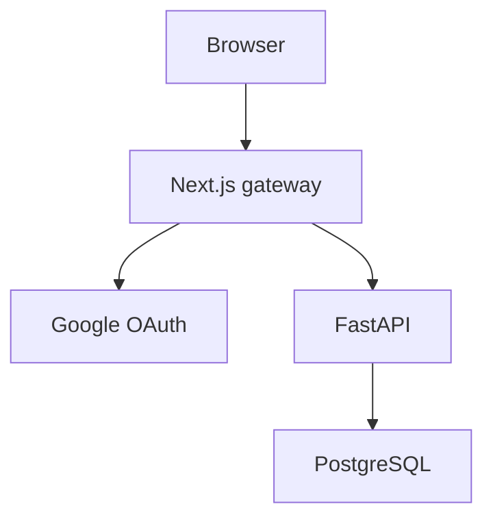

<div align="center">

# College Forum

**A campus conversation starts with a username.**

A campus discussion forum with Google sign-in, permanent usernames, five boards, posts, comments, votes and moderation. Personal Gmail and verified Google Workspace accounts from any domain can join. Members use Google only; there is no email/password sign-up.


[Quick start](#quick-start) · [Architecture](#architecture) · [Testing](#testing)

</div>

---

The database stores a keyed anonymous ID and chosen username, never the Google email, real name, photo or Google ID. This provides pseudonyms, not guaranteed anonymity: Google sees sign-in, hosting providers may retain network logs, and post content can identify its author.

## The problem

Campus discussions need a place for questions, shared experiences and community feedback. College Forum gives members a consistent username and discussion boards, with reporting and administrator tools to manage content.

## At a glance

| Area | What it covers |
| --- | --- |
| Community | Five boards, posts, comments and votes |
| Identity | Google sign-in and keyed pseudonymous member IDs |
| Moderation | Reports, automatic hiding and administrator review |

## Quick start

Requires Node.js 20.9+ and Python 3.11+ (3.12 recommended).

```sh
git clone https://github.com/risbh19/college-forum.git
cd college-forum
npm ci
npm run local
```

Open the printed URL, normally `http://localhost:3000`. On Windows, [Start Local.cmd](Start%20Local.cmd) starts the same app after dependency installation.

The launcher starts portable PostgreSQL, FastAPI and Next.js on loopback. It installs locked Python dependencies on first use and provides shared demo accounts without Google, Supabase, Docker or an `.env` file. Switch accounts by signing out. Demo accounts are shared and are not private.

Local records, credentials and stable identity/session keys stay in ignored `.local/`. Back up that folder privately; never publish it. The launcher adopts existing local data and runs Alembic before starting the backend. Press Ctrl+C to stop the services. Busy ports use the alternatives printed by the launcher.

## Architecture



| Layer | Implementation |
| --- | --- |
| Frontend | Next.js 15 App Router, React 19, TypeScript, Tailwind 3 |
| Authentication | NextAuth v4, Google OAuth, PKCE/state/nonce, seven-day encrypted JWT sessions |
| Backend | FastAPI, strict Pydantic inputs, SQLAlchemy 2 |
| Database | PostgreSQL with Alembic migrations; Supabase supported |
| Abuse controls | Upstash frontend quotas, backend database counters and assertion replay protection |

FastAPI owns business logic, membership, ownership, moderation and database access. Next.js handles authentication, pages and a bounded same-origin gateway; it has no database client. Browser responses expose usernames, with the logged-in user's own anonymous ID as the documented session exception.

The identity algorithm remains `HMAC-SHA256(ANON_PEPPER, lowercase(trim(email)))`, truncated to 32 hex characters. Preserve the pepper permanently for an existing database. The original [Prisma schema](prisma/schema.prisma) remains a migration reference; Alembic owns schema changes and PostgreSQL RLS.

## Deploy

Follow [Vercel + Render + Supabase deployment](docs/DEPLOYMENT.md), or the [Vercel dashboard walkthrough](docs/VERCEL_SETUP.md). Use an External Google audience for personal Gmail and other Workspace organizations. An app in Google's Testing mode still requires approved test accounts.

Use [.env.example](.env.example) for configured local development, and the service-specific examples for hosting:

- [Frontend variables](deploy/frontend.env.example): Google OAuth, NextAuth, stable identity pepper, backend origin/service secret and Upstash settings.
- [Backend variables](deploy/backend.env.example): PostgreSQL connections, backend origin/service secret and administrator allowlist.

Fill secrets privately in your local configuration or hosting dashboard. Never commit `.env`, `.local/`, tokens, database URLs or passwords. Keep database credentials only on FastAPI, Google/session/identity secrets only on Next.js, and the independent service signing secret on both.

Review and back up the intended database before `npm run db:upgrade`. The migration head is `0003_admin_accounts`; existing records and identities are preserved. The Render blueprint selects paid Starter for pre-deploy migrations; review the plan and [deployment alternatives](docs/DEPLOYMENT.md) before creating resources.

## Moderation and administrator access

Three distinct reports auto-hide a post/comment. The backend administrator allowlist controls statistics, content search, hide/restore/delete, report review and account suspension. Public API responses never expose author/reporter account IDs.

The dedicated operator sign-in is available by direct URL at `/admin/login`; it is not linked from the member login page. Configure it privately with [Admin login setup](docs/ADMIN_LOGIN.md). Member Google authentication and the local development demo remain separate.

## Testing

```sh
npm run typecheck
npm run lint
npm test
npm run test:backend
npm run build
npm audit --omit=dev --audit-level=high
```

With `npm run local` running, use `npm run test:local` for actual HTTP/PostgreSQL checks. It accepts only loopback targets and removes its temporary posts. For logged-out frontend checks, use `npm run test:smoke`; set `SMOKE_ORIGIN` when using a different port.

For production, use the read-only `scripts/deployment-smoke.mjs` with your frontend/backend HTTPS origins. Local tests do not verify real Google OAuth, deployed RLS, TLS/proxy settings, live rate limits or backup restoration. See the [verification checklist](docs/VERIFICATION.md). CI checks types, lint, tests, production dependency audit, frontend build and the backend Docker image.

## Repository guide

| Location | Purpose |
| --- | --- |
| `app/`, `components/` | Pages and responsive forum interface |
| `lib/`, `types/`, `middleware.ts` | Authentication, gateway controls and frontend types/helpers |
| `backend/app/` | FastAPI routes, models, validation and authorization |
| `backend/migrations/` | Frozen migration history and schema adoption |
| `tests/`, `backend/tests/` | Frontend/privacy and backend/security regression coverage |
| `scripts/` | Local launcher, Python setup and verification tools |
| `docs/` | [Product/API spec](docs/SPEC.md), [migration notes](docs/FASTAPI_MIGRATION.md), [security review](docs/SECURITY_REVIEW.md) and deployment guides |

Image uploads, post editing, nested replies, notifications, username changes and account-deletion UI are outside this version.
